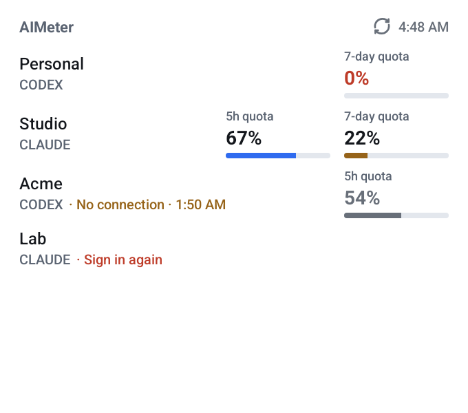
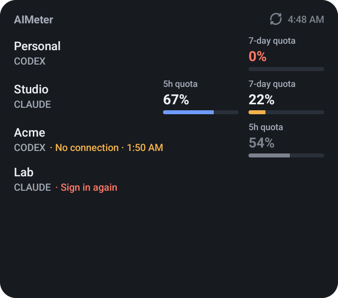
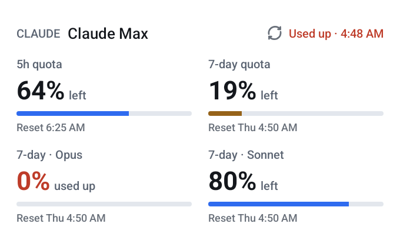

  

<h1 align="center">AIMeter</h1>

How much is left of your ChatGPT (Codex) and Claude plan limits, on your Android home screen.

  
  

AIMeter is a free, open-source Android app for ChatGPT/Codex and Claude **subscriptions**: it shows
every limit window (5 hours, weekly, per model…), how much of it is left and when it resets. It
does not track API billing. No ads, no account of ours, nothing to pay.

## Features

- **Every account at once.** Connect as many Codex and Claude accounts as you like, signing in
  through your phone's browser; none of them is "the main one". Hide, reorder, rename or
  disconnect them in the Accounts tab.
- **Two home-screen widgets.** *Accounts* lists several accounts in one widget, with the figure
  that limits each one or every window with its bar. *Account* shows one account in detail, from
  3×1 to 4×2.
- **Optional persistent notification** with what is left on every visible account.
- **Honest states.** The app and the widgets show when the data is from, and tell stale data, no
  connection, rate limits, provider errors and expired sign-ins apart from real usage. An error is
  never shown as 0 %.
- **Background refresh** every 15 or 30 minutes (Android may delay it while the phone sleeps), or
  manual only.
- English, Spanish and Simplified Chinese; light and dark themes.

  

## Privacy

- Everything stays on the phone: there is no AIMeter server, no analytics, no ads and no
  telemetry.
- Sign-in tokens are stored encrypted (AES-256-GCM) with a key kept in the Android Keystore.
- The app only talks to each provider's own servers, over HTTPS and without following redirects:
  OpenAI for Codex, Anthropic for Claude. A Codex token can never be sent to Anthropic, or the
  other way round.
- Disconnecting an account deletes its data from the phone. For Codex the app also asks OpenAI to
  revoke the sign-in. Anthropic publishes no revocation endpoint, so for Claude only the copy on
  the phone is deleted and the remaining access token expires on its own.

## Before you connect an account

- **Claude:** AIMeter signs in with Claude Code's OAuth client and asks only for the
  `user:profile` permission. That token is still a credential for the Claude account, not a
  read-only key. Anthropic's terms for Claude Code say that third-party developers may not offer
  Claude.ai sign-in or store its tokens, and that Anthropic may act without notice; AIMeter stores
  such a token, so Anthropic could restrict the account. Use it at your own risk, or connect only
  Codex.
- **Codex:** sign-in uses the Codex CLI's OAuth client in the browser, as `codex login` does, with
  a device code as the alternative. OpenAI does not document its use by other apps.
- The usage endpoints the app reads are not public APIs and may change without notice; the app
  then shows an error, never a made-up number.

## Install

- Android 12 or later.
- AIMeter is not on Google Play. Signed APKs, when published, are on the
  [Releases](https://github.com/pnikkosis/AI-meter/releases) page; you can also build it yourself.
- Every release is signed with the same key. Its certificate's SHA-256 fingerprint is
  `1C:F0:5E:0E:20:64:70:29:AE:42:8B:93:DD:7D:02:EB:3B:84:56:D3:4F:89:D6:BF:69:98:F0:E0:D6:FF:F3:8C`.

## Documentation

The detailed documents are in Spanish:

- [Install and use](docs/INSTALAR.md)
- [Build and sign](docs/COMPILAR.md), including how to check that a build is reproducible
- [Security and privacy](docs/SEGURIDAD.md)
- [Test report](docs/INFORME-PRUEBAS.md): what was tested, how, and what still needs a real phone
- [Google Play and provider terms](docs/PRODUCTO-Y-PLAY-STORE.md)
- [Design](DESIGN.md)
- [Changelog](CHANGELOG.md)

`docs/ARCHITECTURE.md`, `docs/SPEC.md`, `docs/PRD.md`, `docs/QA.md` and `docs/research/` are earlier
design notes in Chinese; they describe providers and features that AIMeter does not have.

## License

MIT, see [LICENSE](LICENSE). Third-party notices, including the Geist typeface (SIL Open Font
License 1.1), are in [NOTICE.md](NOTICE.md).

AIMeter is an independent project. It is not affiliated with, endorsed or sponsored by OpenAI or
Anthropic. "ChatGPT", "Codex", "OpenAI", "Claude" and "Anthropic" are trademarks of their
respective owners, used only to name the services whose limits the app shows.
